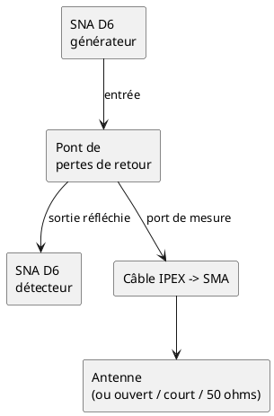
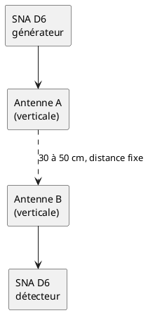

# Diagnostic d'une antenne 2,4 GHz au SNA D6

Contexte : une antenne de point d'accès Wi-Fi récupérée (connecteur IPEX direct), montée sur la
XIAO ESP32-S3, n'a reçu une aide auditive qu'à −91 dBm à courte distance et la connexion BLE est
tombée 1,4 s après l'établissement ; l'antenne d'origine de la XIAO fonctionne (voir
`plan_implementation.md`, Phase 6, migration XIAO, 2026-10-11).

Matériel : SNA D6 (analyseur scalaire 32 MHz – 4,4 GHz, détecteur logarithmique AD8307, logiciel
SNASharp), pont de pertes de retour, câble IPEX → SMA court, charge 50 Ω. Le premier NanoVNA ne
monte pas à 2,4 GHz. Le SNA mesure l'amplitude, pas la phase : il dit si l'antenne est bonne, pas
comment la réadapter.

Bande utile : **2,40 – 2,48 GHz** (BLE et Wi-Fi 2,4 GHz).

## 1. Adaptation : pertes de retour avec le pont

1. **Plan de référence** : faire toutes les références au bout du câble IPEX → SMA (côté IPEX),
   pour que ses pertes soient incluses.
2. **Directivité du pont** : charge 50 Ω au bout du câble, relever le niveau sur 2,40 – 2,48 GHz.
   C'est le plancher de mesure ; les petits ponts bon marché tombent parfois à ~20 dB à 2,4 GHz.
   Une mesure proche de ce plancher n'est pas exploitable.
3. **Référence 0 dB** : bout du câble en circuit ouvert, puis en court-circuit ; la moyenne des
   deux donne le 0 dB de pertes de retour.
4. **Mesure** : brancher chaque antenne, éloignée de tout métal (> 15 cm, plus d'une longueur
   d'onde de 12,5 cm), sans la tenir près de l'élément rayonnant.
   - Bonne antenne : **pertes de retour ≥ 10 dB** (ROS < 2) sur 2,40 – 2,48 GHz.
   - Mesurer aussi l'**antenne d'origine de la XIAO** : c'est la référence qui marche.

**Piège** : un coaxial à fortes pertes, ou à moitié coupé (fréquent au ras du connecteur IPEX sur
un appareil démonté), absorbe le signal qui ne revient pas → la mesure paraît **bien adaptée**.
De bonnes pertes de retour ne suffisent donc pas à innocenter l'antenne : faire aussi l'essai 2.

## 2. Transmission entre antennes (le vrai juge)

- Une antenne sur le générateur, une sur le détecteur, à distance fixe (30 – 50 cm), toutes deux
  verticales, sur une table dégagée ; ne rien bouger d'autre entre les mesures.
- Mesurer **tous les couples** parmi : antenne d'origine, antenne de point d'accès n° 1, n° 2.
- Lire le niveau à 2,44 GHz. Les couples qui incluent une antenne défaillante perdent ~15 – 20 dB
  ou plus par rapport aux autres ; avec trois antennes, la mauvaise se désigne sans ambiguïté.
- Cette mesure n'est pas trompée par un câble à pertes, contrairement à l'essai 1.

| Couple | Niveau à 2,44 GHz (dB) |
|---|---|
| origine ↔ PA n° 1 | |
| origine ↔ PA n° 2 | |
| PA n° 1 ↔ PA n° 2 | |

## 3. Contrôles sans banc

- **Visuel** : câble pincé ou plié net près de l'IPEX, gaine écrasée, connecteur ouvert ou déformé.
- **Ohmmètre, antenne débranchée** : entre l'âme et la masse de l'IPEX, circuit ouvert ou
  court-circuit en continu selon la conception (dipôle ou boucle d'adaptation) — comparer deux
  antennes identiques plutôt que se fier à une valeur absolue ; continuité de l'âme et de la masse
  si le câble se démonte du boîtier.
- **Comparatif sur la XIAO** : un petit firmware qui affiche toutes les secondes le RSSI Wi-Fi de
  la box (source fixe et stable) ; changer d'antenne sans bouger la carte. Quelques dB d'écart
  sont normaux, ≥ 20 dB signale une antenne morte ou un câble coupé. Plus fiable que les aides
  auditives, dont le RSSI varie de 10 – 20 dB au moindre mouvement.

Référence matériel : [blog SNA D6](https://alloza.eu/david/WordPress3/?cat=91).
